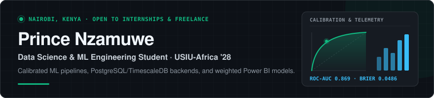
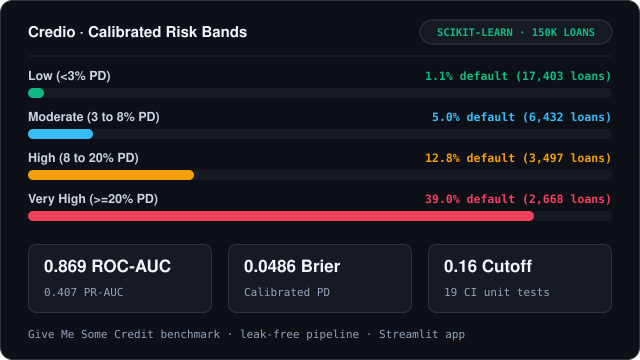
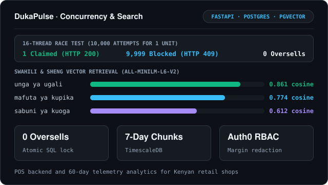
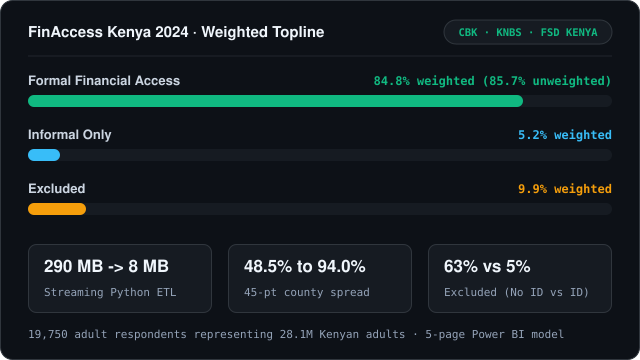
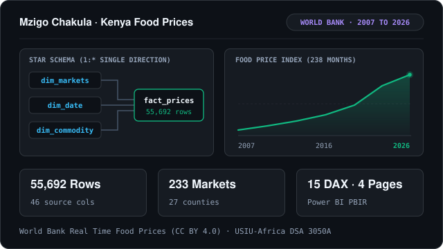

  <a href="https://nzamuwe.com">
    <picture>
      <source media="(prefers-color-scheme: dark)" srcset="./assets/hero-dark.svg" />
      <source media="(prefers-color-scheme: light)" srcset="./assets/hero-light.svg" />
      
    </picture>
  </a>

  
  
  
  

  
  
  

Mastercard Foundation Scholar in BSc Data Science &amp; Analytics at USIU-Africa, previously trained in the Andela Technical Leadership Program (ATLP) and ALX Software Engineering Foundations. Every project below ships with reproducible pipelines, automated tests, or benchmark reconciliation against primary data.

<h2> Selected Projects</h2>

<table width="100%">
  <tr>
    <td width="50%" valign="top">
      <a href="https://credio.nzamuwe.com/">
        <picture>
          <source media="(prefers-color-scheme: dark)" srcset="./assets/card-credio-dark.svg" />
          <source media="(prefers-color-scheme: light)" srcset="./assets/card-credio-light.svg" />
          
        </picture>
      </a>
      
<strong>Credio: Credit-Risk Scorecard</strong>

      
Leak-free scikit-learn scorecard on 150,000 borrower records with calibrated risk bands (1.1% to 39.0% default) and a 5:1 cost-based approval cutoff.

      

        
        
        
      

    </td>
    <td width="50%" valign="top">
      <a href="https://dukapulse.streamlit.app">
        <picture>
          <source media="(prefers-color-scheme: dark)" srcset="./assets/card-dukapulse-dark.svg" />
          <source media="(prefers-color-scheme: light)" srcset="./assets/card-dukapulse-light.svg" />
          
        </picture>
      </a>
      
<strong>DukaPulse: Retail POS &amp; Telemetry Backend</strong>

      
FastAPI and PostgreSQL retail backend preventing concurrent oversells under 16-thread contention, paired with TimescaleDB rollups and Auth0 RBAC.

      

        
        
        
      

    </td>
  </tr>
  <tr>
    <td width="50%" valign="top">
      <a href="https://nzamuwe.com/projects/finaccess">
        <picture>
          <source media="(prefers-color-scheme: dark)" srcset="./assets/card-finaccess-dark.svg" />
          <source media="(prefers-color-scheme: light)" srcset="./assets/card-finaccess-light.svg" />
          
        </picture>
      </a>
      
<strong>FinAccess Kenya 2024: Financial Inclusion BI</strong>

      
Streaming Python XML parser compacting a 290 MB national survey into 8 MB of weighted adult records reconciled to CBK and KNBS benchmarks.

      

        
        
        
      

    </td>
    <td width="50%" valign="top">
      <a href="https://github.com/princenzmw/mzigo-chakula">
        <picture>
          <source media="(prefers-color-scheme: dark)" srcset="./assets/card-mzigo-dark.svg" />
          <source media="(prefers-color-scheme: light)" srcset="./assets/card-mzigo-light.svg" />
          
        </picture>
      </a>
      
<strong>Mzigo Chakula: Kenya Food Inflation (2007 to 2026)</strong>

      
238-month World Bank market price model across 27 Kenyan counties built with a 4-table star schema, 15 DAX measures, and a 4-page PBIR report.

      

        
        
        
      

    </td>
  </tr>
</table>

  
More Public Projects (Time-Series, Vector Search, Web3, and Multi-Agent Systems)

| Project | Summary | Stack | Link |
| :--- | :--- | :--- | :--- |
| [grid-ops-search](https://github.com/princenzmw/grid-ops-search) | Hybrid semantic and time-series search joining maintenance notes and telemetry in SQL. | Python, PostgreSQL, TimescaleDB, pgvectorscale | [Source](https://github.com/princenzmw/grid-ops-search) |
| [VoltStream](https://github.com/princenzmw/voltstream) | Real-time power-grid telemetry simulator and Streamlit monitor backed by TimescaleDB hypertables. | Python, TimescaleDB, Streamlit, Plotly | [Source](https://github.com/princenzmw/voltstream) |
| [Tiririka](https://github.com/princenzmw/tiririka) | Pay-per-litre water kiosk protocol using off-chain Ed25519 Solana payment channels. | TypeScript, Next.js, Solana, Anchor | [Live App](https://tiririka.vercel.app) · [Source](https://github.com/princenzmw/tiririka) |
| [EduFaster-AI](https://github.com/princenzmw/EduFaster-AI) | Multi-agent Python basics tutor routing explainer, quiz, and review nodes via LangGraph. | Python, LangGraph, Gemini, Streamlit | [Source](https://github.com/princenzmw/EduFaster-AI) |

<h2> Core Stack</h2>

  <picture>
    <source media="(prefers-color-scheme: dark)" srcset="https://skillicons.dev/icons?i=py%2Cpostgres%2Cfastapi%2Csklearn%2Cdocker%2Cgithubactions%2Cts%2Cnextjs%2Cflask%2Clinux%2Cgit&theme=dark" />
    <source media="(prefers-color-scheme: light)" srcset="https://skillicons.dev/icons?i=py%2Cpostgres%2Cfastapi%2Csklearn%2Cdocker%2Cgithubactions%2Cts%2Cnextjs%2Cflask%2Clinux%2Cgit&theme=light" />
    
  </picture>

  
  
  
  
  
  
  
  

<h2> Activity and Languages</h2>

<table width="100%">
  <tr>
    <td width="63%" valign="middle" align="center">
      <picture>
        <source media="(prefers-color-scheme: dark)" srcset="https://github-readme-activity-graph.vercel.app/graph?username=princenzmw&bg_color=0d1117&color=e6edf3&line=10b981&point=38bdf8&area=true&area_color=10b981&hide_border=true&custom_title=30-Day%20Contribution%20Activity" />
        <source media="(prefers-color-scheme: light)" srcset="https://github-readme-activity-graph.vercel.app/graph?username=princenzmw&bg_color=ffffff&color=0f172a&line=059669&point=0284c7&area=true&area_color=10b981&hide_border=true&custom_title=30-Day%20Contribution%20Activity" />
        
      </picture>
    </td>
    <td width="37%" valign="middle" align="center">
      <picture>
        <source media="(prefers-color-scheme: dark)" srcset="https://github-readme-stats.vercel.app/api/top-langs/?username=princenzmw&layout=compact&langs_count=6&hide_border=true&bg_color=0d1117&title_color=f0f6fc&text_color=c9d1d9" />
        <source media="(prefers-color-scheme: light)" srcset="https://github-readme-stats.vercel.app/api/top-langs/?username=princenzmw&layout=compact&langs_count=6&hide_border=true&bg_color=ffffff&title_color=0f172a&text_color=334155" />
        
      </picture>
    </td>
  </tr>
</table>
