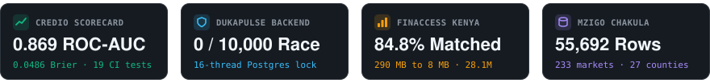
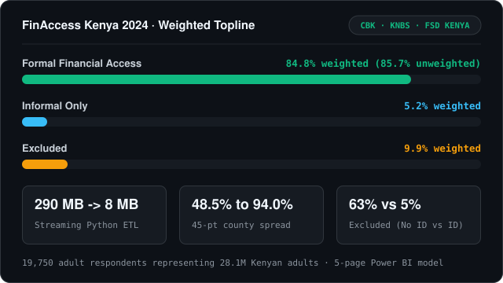

  <a href="https://nzamuwe.com">
    <picture>
      <source media="(prefers-color-scheme: dark)" srcset="./assets/hero-dark.svg" />
      <source media="(prefers-color-scheme: light)" srcset="./assets/hero-light.svg" />
      
    </picture>
  </a>

  
  
  

  
  
  

I build end-to-end data products in Python and SQL: calibrated machine learning pipelines, PostgreSQL and TimescaleDB backends, and weighted Power BI models. Mastercard Foundation Scholar at USIU-Africa, previously trained through the Andela Technical Leadership Program (ATLP) and ALX Software Engineering Foundations.

  <picture>
    <source media="(prefers-color-scheme: dark)" srcset="./assets/metrics-dark.svg" />
    <source media="(prefers-color-scheme: light)" srcset="./assets/metrics-light.svg" />
    
  </picture>

<h2> Selected Projects</h2>

<table width="100%">
  <tr>
    <td width="50%" valign="top">
      
      
<strong>Credio: Credit-Risk Scorecard</strong>

      
Leak-free scikit-learn pipeline trained on 150,000 Give Me Some Credit borrower records. Achieves 0.869 ROC-AUC, 0.407 PR-AUC, and 0.0486 Brier score on 30,000 held-out records with a cost-based decision threshold and 19 CI unit tests.

      

        
        
        
      

    </td>
    <td width="50%" valign="top">
      
      
<strong>DukaPulse: Retail POS &amp; Telemetry Backend</strong>

      
FastAPI and PostgreSQL backend for Kenyan retail shops. Atomic stock updates verified against a 16-thread, 10,000-attempt oversell race test, TimescaleDB continuous aggregates, pgvector Swahili/Sheng search, and Auth0 margin redaction.

      

        
        
        
      

    </td>
  </tr>
  <tr>
    <td width="50%" valign="top">
      <a href="https://nzamuwe.com/projects/finaccess">
        <picture>
          <source media="(prefers-color-scheme: dark)" srcset="./assets/finaccess-dark.svg" />
          <source media="(prefers-color-scheme: light)" srcset="./assets/finaccess-light.svg" />
          
        </picture>
      </a>
      
<strong>FinAccess Kenya 2024: Financial Inclusion BI</strong>

      
Streaming Python ETL pipeline compacting the 290 MB CBK/KNBS/FSD Kenya household survey into an 8 MB weighted dataset (19,750 adults representing 28.1M). Reconciles to 84.8% formal access and 9.9% excluded in a 5-page Power BI report.

      

        
        
        
      

    </td>
    <td width="50%" valign="top">
      
      
<strong>Mzigo Chakula: Kenya Food Inflation (2007 to 2026)</strong>

      
County-level food affordability analysis across 55,692 World Bank Real Time Food Prices rows covering 233 markets and 27 counties. Built as a 4-table star schema with 15 DAX measures and a 4-page Power BI PBIR report (USIU-Africa DSA 3050A).

      

        
        
      

    </td>
  </tr>
</table>

  
More Public Projects (Time-Series, Vector Search, Web3, and Multi-Agent Systems)

| Project | Summary | Stack | Link |
| :--- | :--- | :--- | :--- |
| [grid-ops-search](https://github.com/princenzmw/grid-ops-search) | Hybrid semantic and time-series search joining maintenance notes and telemetry in SQL. | Python, PostgreSQL, TimescaleDB, pgvectorscale | [Source](https://github.com/princenzmw/grid-ops-search) |
| [VoltStream](https://github.com/princenzmw/voltstream) | Real-time power-grid telemetry simulator and Streamlit monitor backed by TimescaleDB hypertables. | Python, TimescaleDB, Streamlit, Plotly | [Source](https://github.com/princenzmw/voltstream) |
| [Tiririka](https://github.com/princenzmw/tiririka) | Pay-per-litre water kiosk protocol using off-chain Ed25519 Solana payment channels. | TypeScript, Next.js, Solana, Anchor | [Live App](https://tiririka.vercel.app) · [Source](https://github.com/princenzmw/tiririka) |
| [EduFaster-AI](https://github.com/princenzmw/EduFaster-AI) | Multi-agent Python basics tutor routing explainer, quiz, and review nodes via LangGraph. | Python, LangGraph, Gemini, Streamlit | [Source](https://github.com/princenzmw/EduFaster-AI) |

<h2> Core Stack</h2>

  <picture>
    <source media="(prefers-color-scheme: dark)" srcset="https://skillicons.dev/icons?i=py,postgres,fastapi,sklearn,docker,githubactions,ts,nextjs,flask,linux,git&theme=dark" />
    <source media="(prefers-color-scheme: light)" srcset="https://skillicons.dev/icons?i=py,postgres,fastapi,sklearn,docker,githubactions,ts,nextjs,flask,linux,git&theme=light" />
    
  </picture>

  
  
  
  
  
  
  
  

<h2> Activity and Languages</h2>

  <picture>
    <source media="(prefers-color-scheme: dark)" srcset="https://github-readme-activity-graph.vercel.app/graph?username=princenzmw&bg_color=0d1117&color=e6edf3&line=10b981&point=38bdf8&area=true&area_color=10b981&hide_border=true&custom_title=30-Day%20Contribution%20Activity" />
    <source media="(prefers-color-scheme: light)" srcset="https://github-readme-activity-graph.vercel.app/graph?username=princenzmw&bg_color=ffffff&color=0f172a&line=059669&point=0284c7&area=true&area_color=10b981&hide_border=true&custom_title=30-Day%20Contribution%20Activity" />
    
  </picture>

  <picture>
    <source media="(prefers-color-scheme: dark)" srcset="https://github-readme-stats.vercel.app/api/top-langs/?username=princenzmw&layout=compact&langs_count=6&hide_border=true&bg_color=0d1117&title_color=e6edf3&text_color=8b949e" />
    <source media="(prefers-color-scheme: light)" srcset="https://github-readme-stats.vercel.app/api/top-langs/?username=princenzmw&layout=compact&langs_count=6&hide_border=true&bg_color=ffffff&title_color=0f172a&text_color=475569" />
    
  </picture>

  <picture>
    <source media="(prefers-color-scheme: dark)" srcset="https://raw.githubusercontent.com/princenzmw/princenzmw/output/github-contribution-grid-snake-dark.svg" />
    <source media="(prefers-color-scheme: light)" srcset="https://raw.githubusercontent.com/princenzmw/princenzmw/output/github-contribution-grid-snake.svg" />
    
  </picture>

